  

  

  

  <a href="https://github.com/kingsneverdie17/TeachTool-9661"><b>TeachTool</b></a> ·
  <a href="https://github.com/kingsneverdie17/BMI-project-Flask"><b>BMI Hub</b></a> ·
  <a href="mailto:zhill2707@gmail.com">Email</a>

  

